# Billing Module Architecture

This document describes the internal architecture of the x/billing module for developers who need to understand, maintain, or extend the module.

## Overview

The Billing module implements a cloud-like billing system where tenants lease resources (SKUs) and are charged from a pre-funded credit account. Key features:

- **PENDING → ACTIVE lifecycle**: Leases start in PENDING state and require provider acknowledgement before billing begins
- **UUIDv7 identifiers**: Providers, SKUs, and Leases use deterministic UUIDv7 for unique identification
- **Multi-denom support**: Different SKUs can use different payment tokens
- **Lazy stream settlement**: Accrual is aggregated per `(provider, tenant, denom)` stream and paid on demand (withdrawal, acknowledgement, closure), never per block and never per lease
- **Automatic expiration**: EndBlocker expires pending leases that exceed timeout
- **Deferred auto-close**: A settlement that finds a tenant's credit exhausted freezes the stream; the EndBlocker then closes its leases, a bounded number per block

## Module Dependencies

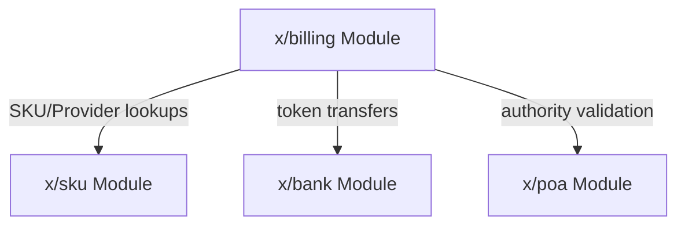

The Billing module:
- **Depends on**: 
  - `x/sku` for SKU and Provider information (UUIDs, prices, payout addresses)
  - `x/bank` for token transfers
  - `x/poa` for authority validation

## Data Model

### Entity Relationship Diagram

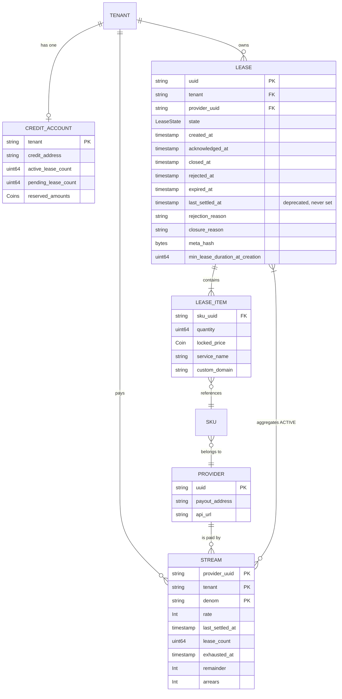

### CreditAccount

Credit accounts hold pre-funded tokens for lease payments:

| Field | Type | Description |
|-------|------|-------------|
| `tenant` | `string` | Tenant's original address (primary key) |
| `credit_address` | `string` | Derived credit account address |
| `active_lease_count` | `uint64` | Number of ACTIVE leases |
| `pending_lease_count` | `uint64` | Number of PENDING leases |
| `reserved_amounts` | `[]Coin` | Sum of all credit reservations for active and pending leases. Each lease reserves `rate_per_second × min_lease_duration` per denom to prevent overbooking. |

**Address Derivation:**
```go
// Uses the Cosmos SDK's address.Module function for proper module account derivation
key := append([]byte("billing/credit/"), tenantAddr.Bytes()...)
hash := sha256.Sum256(key)
creditAddr = address.Module("billing", hash[:])
```

See `x/billing/types/credit.go` for the implementation.

### Lease

Leases represent resource rentals with full lifecycle tracking:

| Field | Type | Description |
|-------|------|-------------|
| `uuid` | `string` | UUIDv7 unique identifier |
| `tenant` | `string` | Tenant address |
| `provider_uuid` | `string` | Provider UUID (denormalized for efficient querying) |
| `items` | `[]LeaseItem` | List of SKU items in this lease |
| `state` | `LeaseState` | PENDING, ACTIVE, CLOSED, REJECTED, or EXPIRED |
| `created_at` | `Timestamp` | When lease was created (credit locked) |
| `acknowledged_at` | `*Timestamp` | When provider acknowledged (billing starts) |
| `closed_at` | `*Timestamp` | When lease was closed |
| `rejected_at` | `*Timestamp` | When provider rejected |
| `expired_at` | `*Timestamp` | When lease expired in PENDING state |
| `last_settled_at` | `*Timestamp` | **Deprecated.** Never set by the node and rejected in genesis. Settlement is tracked per stream (see [Stream](#stream)). |
| `rejection_reason` | `string` | Provider's rejection explanation (max 256 chars) |
| `closure_reason` | `string` | Explanation for why the lease was closed (max 256 chars) |
| `meta_hash` | `bytes` | Optional hash/reference to off-chain deployment data (max 64 bytes, immutable) |
| `min_lease_duration_at_creation` | `uint64` | The `min_lease_duration` parameter value at lease creation time, for consistent reservation calculation |

### LeaseItem

Individual line items within a lease:

| Field | Type | Description |
|-------|------|-------------|
| `sku_uuid` | `string` | Reference to SKU (UUIDv7) |
| `quantity` | `uint64` | Number of units (e.g., 5 instances) |
| `locked_price` | `Coin` | Per-second price locked at lease creation (includes denom) |
| `service_name` | `string` | Optional RFC 1123 DNS label for stack deployments (1-63 lowercase alphanumeric/hyphens) |
| `custom_domain` | `string` | Optional FQDN (≤253 bytes) routed to this item by the provider — see [Custom Domains](#custom-domains-per-item) (v2.1.0+) |

**Note**: The `locked_price` is pre-computed at lease creation as the per-second rate for billing calculations. This is derived from the SKU's base price and unit at the time of lease creation. The denomination is preserved from the SKU's `base_price`, enabling multi-denom billing.

**Service Names**: When `service_name` is set, all items in the lease must have one (all-or-nothing). Uniqueness shifts from `sku_uuid` to `service_name`, allowing the same SKU to appear multiple times for different named services (e.g., "web" and "db" both using a docker-small SKU). This enables stack deployments where the off-chain orchestrator maps each service to its container.

**Custom Domains**: `custom_domain` is mutable post-creation via `MsgSetItemCustomDomain` (`service_name` and the rest of the lease are immutable). Globally unique while the lease is PENDING/ACTIVE — enforced through the `CustomDomainIndex` reverse-index that maps `domain → CustomDomainTarget{lease_uuid, service_name}`. See [Custom Domains](#custom-domains-per-item) for the full flow.

> **Compute-specific fields:** `service_name` and `custom_domain` are pragmatic shortcuts that live on `LeaseItem` today. They will migrate to a future `x/deployment` module once a non-compute lease kind ships (tracked: ENG-80).

### LeaseState Enum

```
LEASE_STATE_UNSPECIFIED = 0  // Invalid
LEASE_STATE_PENDING     = 1  // Awaiting provider acknowledgement (credit locked, not billing)
LEASE_STATE_ACTIVE      = 2  // Provider acknowledged, billing active
LEASE_STATE_CLOSED      = 3  // Terminated normally
LEASE_STATE_REJECTED    = 4  // Provider rejected OR tenant cancelled (credit unlocked)
LEASE_STATE_EXPIRED     = 5  // Pending timeout exceeded (credit unlocked)
```

**Note on REJECTED State**: The `REJECTED` state is used for both provider rejections and tenant cancellations. When a tenant cancels their pending lease via `MsgCancelLease`, the lease transitions to `REJECTED` state with `rejection_reason` set to `"cancelled by tenant"`. This design choice simplifies state management by treating all pre-acknowledgement terminations uniformly. The `lease_cancelled` event is emitted to distinguish tenant cancellations from provider rejections (which emit `lease_rejected`).

### Stream

A stream aggregates every ACTIVE lease one tenant holds with one provider in one denom. It is the unit of settlement: accrual is paid once per stream instead of once per lease. A stream is identified by `(provider_uuid, tenant, denom)` and stores a `StreamState`:

| Field | Type | Description |
|-------|------|-------------|
| `rate` | `math.Int` | Summed per-second rate of the stream's ACTIVE leases: `sum(locked_price × quantity)` over their items priced in the stream's denom |
| `last_settled_at` | `Timestamp` | Time up to which the stream's accrual has been settled. Every settlement sets it to the block time. |
| `lease_count` | `uint64` | Number of ACTIVE leases contributing to `rate` |
| `exhausted_at` | `*Timestamp` | Set when a settlement found the tenant's credit exhausted in the stream's denom. An exhausted (frozen) stream stops accruing and its leases are closed by the EndBlocker. |
| `remainder` | `math.Int` | Accrual that did not amount to a whole unit of the denom at the last settlement, carried to the next one. Expressed in (denom units × nanoseconds), always in `[0, 1,000,000,000)`: less than one whole unit. See [Accrual Formula](#accrual-formula). |
| `arrears` | `math.Int` | Amount, in whole units of the denom, that the stream owes the provider on top of what it accrues since `last_settled_at`. The next settlement pays it together with the accrual and sets it to 0; if the credit does not cover it, the stream freezes as for any other shortfall. The 2 → 3 store migration sets it to what the stream's leases had accrued under per-lease settlement and not yet been paid at the upgrade; it is zero otherwise. Never negative. |

`Stream` (`provider_uuid`, `tenant`, `denom`, `state`) is the shape used in genesis and in query responses.

**Tenant identity.** A stream identifies its tenant by address, not by how the address string is spelled. Bech32 is also valid in upper case and a lease stores its tenant as it was sent, so `Lease.tenant` may be upper case while `Stream.tenant` is always the canonical lower-case spelling. Stream identifiers are built from the parsed address (`types.NewStreamID`), and string spellings are canonicalized before they are compared or used as map keys (`types.CanonicalAddress`).

**Invariant** (`types/stream.go`, checked by `Keeper.CheckStreamInvariant`): for every `(provider_uuid, tenant, denom)`,

```
Stream.Rate       == SUM(locked_price × quantity) over the denom's items
                     of all ACTIVE leases of that tenant with that provider
Stream.LeaseCount == number of those leases
```

and a stream exists if and only if `LeaseCount > 0`. An exhausted stream keeps its rate and lease count; it only stops accruing. A lease priced in several denoms belongs to one stream per denom.

## Storage Layout

### Collections

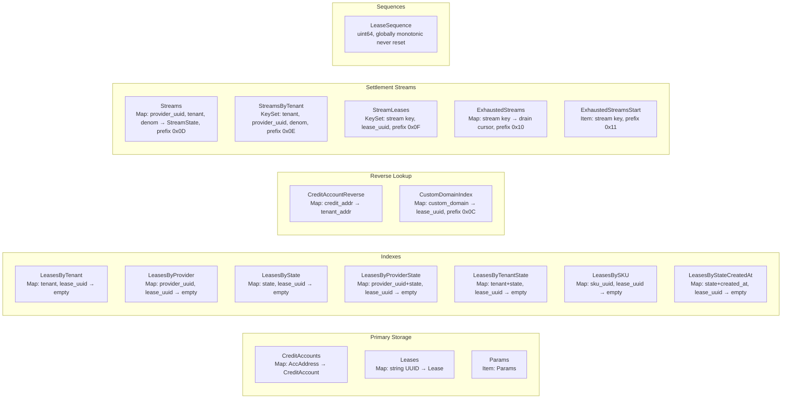

| Collection | Key Type | Value Type | Purpose |
|------------|----------|------------|---------|
| `CreditAccounts` | `sdk.AccAddress` | `CreditAccount` | Credit account storage |
| `CreditAccountReverse` | `sdk.AccAddress` | `sdk.AccAddress` | O(1) credit account detection |
| `Leases` | `string` (UUID) | `Lease` | Primary lease storage |
| `LeasesByTenant` | `(AccAddress, string)` | `bool` | Tenant → leases index |
| `LeasesByProvider` | `(string, string)` | `bool` | Provider UUID → leases index |
| `LeasesByState` | `(int32, string)` | `bool` | State → leases index (state-filtered lease queries) |
| `LeasesByProviderState` | `(string, int32, string)` | `bool` | Compound provider+state → leases index |
| `LeasesByTenantState` | `(AccAddress, int32, string)` | `bool` | Compound tenant+state → leases index |
| `LeasesBySKU` | `(string, string)` | `bool` | Many-to-many SKU → leases index |
| `LeasesByStateCreatedAt` | `(int32, time.Time, string)` | `bool` | Compound state+created_at → leases index (time-ordered; range-queried by EndBlocker to scan only expirable pending leases) |
| `CustomDomainIndex` | `string` (lower-cased domain) | `CustomDomainTarget` | Reverse lookup `custom_domain → (lease_uuid, service_name)` for O(1) `QueryLeaseByCustomDomain`. Reconciled by `SetLease` whenever lease items change; freed on close/reject/expire/auto-close. |
| `Streams` | `(string, (AccAddress, string))` = (provider UUID, (tenant, denom)) | `StreamState` | Settlement aggregate per stream. Provider-first ordering lets a withdrawal range over exactly one provider's streams. A plain `Map`, not an `IndexedMap`: a stream is rewritten on every settlement and an `IndexedMap` would rewrite every index each time. |
| `StreamsByTenant` | `(AccAddress, (string, string))` = (tenant, (provider UUID, denom)) | - (`KeySet`) | Reverse lookup for `StreamsByTenant` and `CreditEstimate`. Maintained by hand, written only when a stream is created or deleted, never on settlement. |
| `StreamLeases` | `((stream key), string)` = (stream key, lease UUID) | - (`KeySet`) | Stream membership: one entry per ACTIVE lease and denom it is priced in. Lets the EndBlocker enumerate exactly the leases of an exhausted stream. |
| `ExhaustedStreams` | stream key | `string` | Queue of exhausted streams whose leases the EndBlocker still has to close. The value is the drain cursor: the UUID of the last lease that failed to close (empty at start). |
| `ExhaustedStreamsStart` | - (`Item`) | stream key | Key of the last queued stream the drain served. The next block resumes the walk of `ExhaustedStreams` after it, so the drain rotates through the queue instead of always starting at its head. Unset unless more streams are queued than one block can serve. |
| `LeaseSequence` | - | `uint64` | Monotonic counter feeding deterministic lease UUIDv7 generation |
| `Params` | - | `Params` | Module parameters |

Streams are removed in one place only (`deleteStream`), which drops the stream together with its `StreamsByTenant` entry and any `ExhaustedStreams` entry.

## Core Flows

### Lease Lifecycle

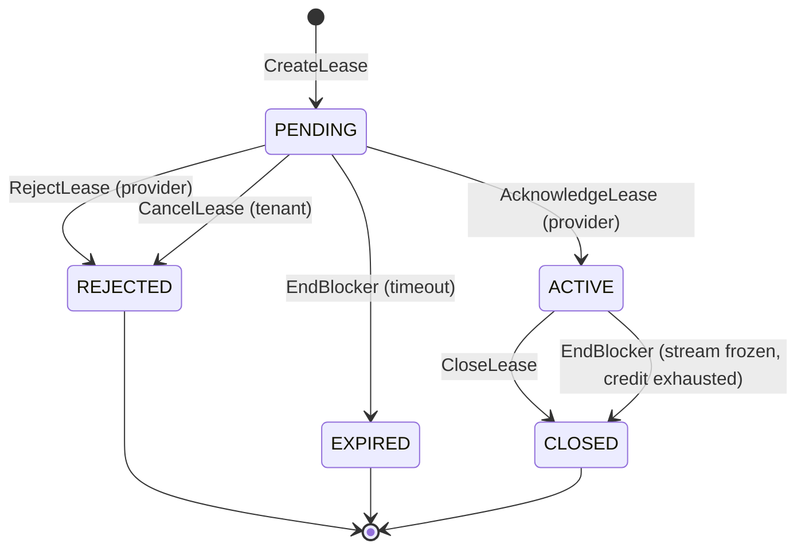

### Fund Credit Account

Uses CacheContext for atomicity - either both token transfer and credit account creation succeed, or neither does.

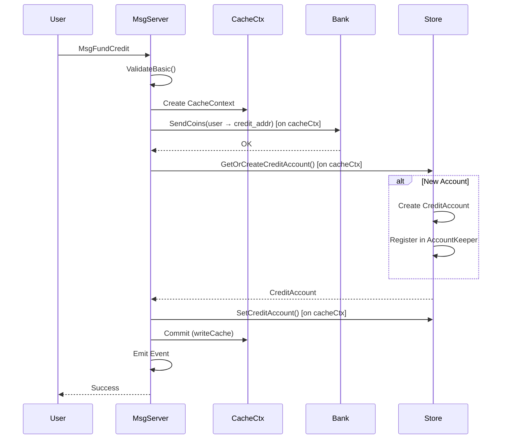

**Atomicity Guarantee**: If `SetCreditAccount` fails after `SendCoins` succeeds, the cache is discarded and no state changes occur - tokens are not transferred and no credit account is created.

### Create Lease (PENDING State)

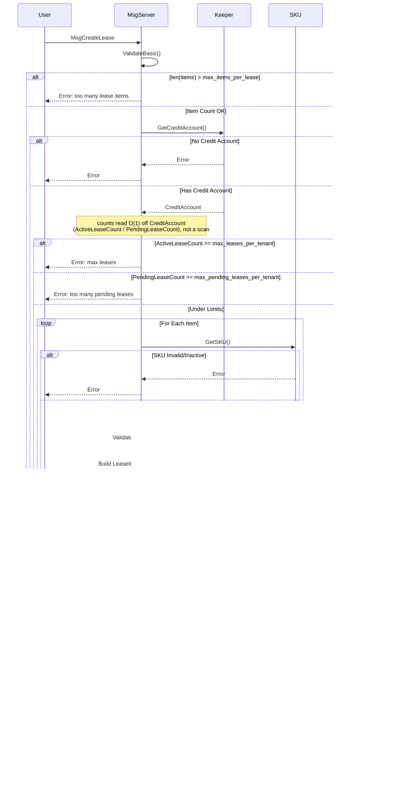

### Acknowledge Lease (PENDING → ACTIVE)

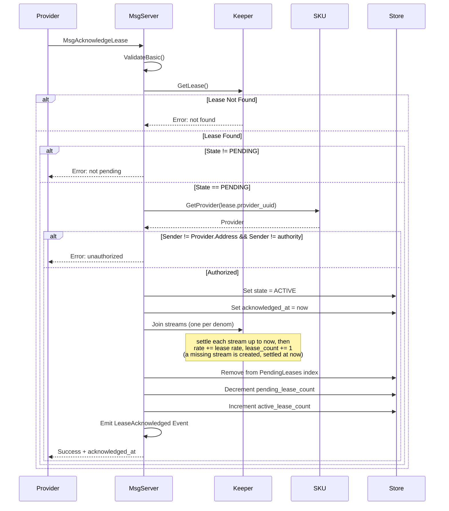

### Reject Lease (PENDING → REJECTED)

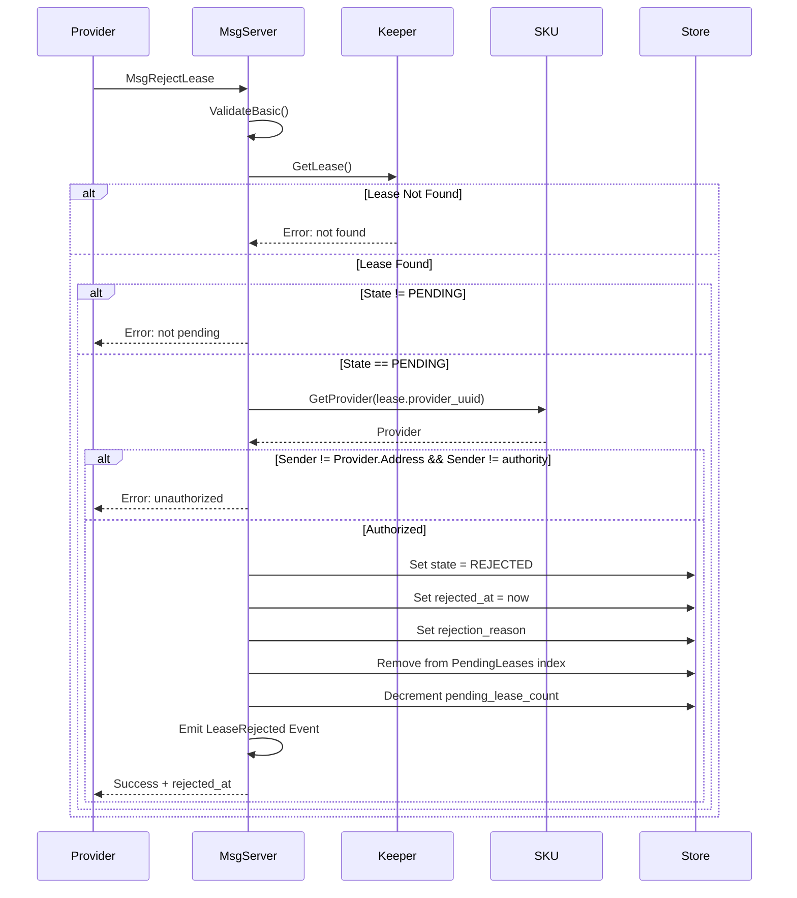

### Settlement (Lazy Evaluation)

Settlement happens per stream, when a provider withdraws or when a lease joins or leaves the stream, not continuously. Settling a stream never reads its leases: the stream already holds their summed rate.

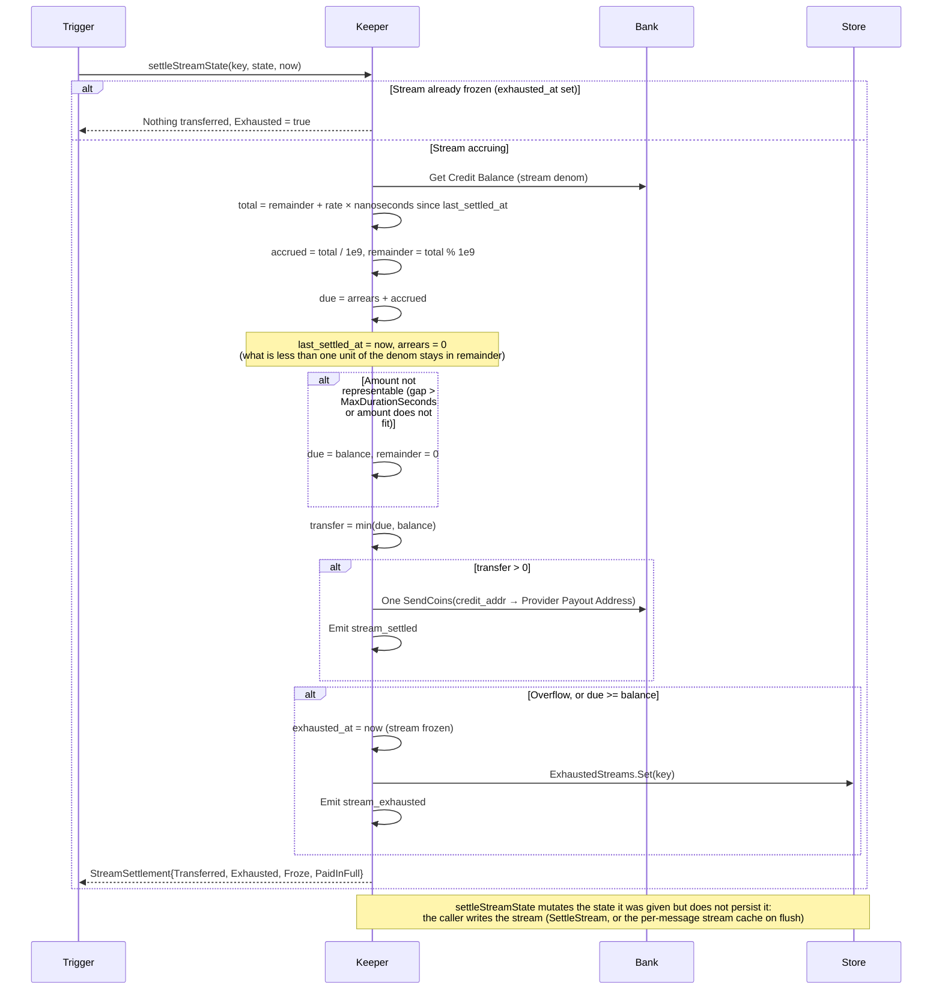

**Once per message.** `AcknowledgeLease`, `CloseLease` and each EndBlocker closure go through a per-message `streamCache` (`keeper/stream.go`): a stream is read once, settled once and written once however many leases of the batch belong to it. Closing 382 leases of one stream therefore does one transfer and one stream write, not 382. `streamCache.join` adds a lease to its streams, `streamCache.leave` removes it, and `flush` writes every touched stream in first-touch order, deleting any stream left without leases.

**`PaidInFull`.** A stream freezes on a GTE boundary (`due >= balance`, where `due` is the accrual plus any arrears), so it also freezes when the credit exactly covers a positive charge. `PaidInFull` records that case; a settlement is a genuine credit exhaustion only when the stream is frozen and the charge was not simply paid in full (an unpaid remainder, an accrual overflow, a zero balance with nothing accrued, or a stream that was already frozen).

### Close Lease with Settlement

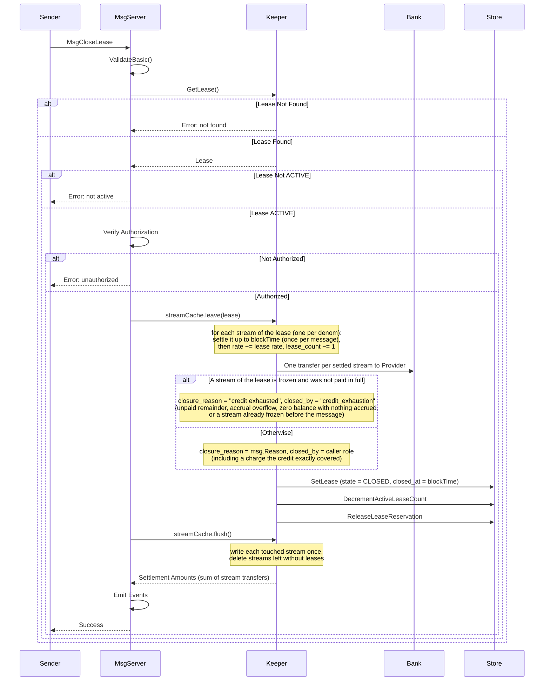

The diagram shows one lease; `MsgCloseLease` takes 1-100 lease UUIDs, validates them all first, then applies every change in one `CacheContext` (all leases close or none do). Three properties follow from settling per stream:

- **`total_settled_amounts` is per stream, not per lease.** It is the sum of the stream transfers of the message: closing 1 of N leases of a stream pays the accrual of all N.
- **The closure reason does not depend on batch order.** Every lease of the batch that shares a stream sees the same settlement.
- **`closed_at` is the block time.** A lease closed through `MsgCloseLease` while its stream is frozen is still stamped with the time of the closing block, not the time the credit ran out.

### Withdrawal Flow

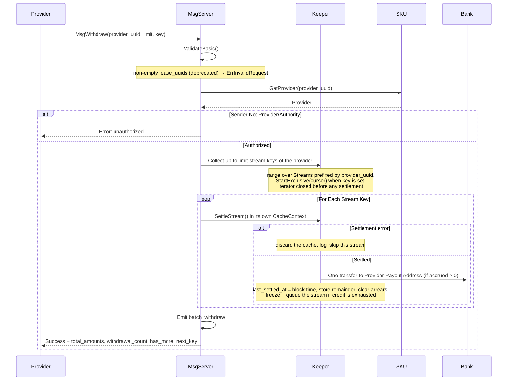

Notes on the flow:

- **Cost is O(streams), not O(leases).** No lease is read or written. A stream that aggregates 1, 50 or 382 leases costs about the same to settle (about 54k gas for a one-stream withdrawal in `TestStream_WithdrawGasIndependentOfLeaseCount`).
- **`limit`** counts streams: 0 means the default of 50 (`DefaultProviderWithdrawLimit`), the maximum is 100 (`MaxBatchLeaseSize`).
- **`withdrawal_count`** is the number of streams that paid out. A stream with nothing to pay (for example, a second withdrawal in the same block, an accrual still below one unit of the denom, or a frozen stream) is settled but not counted.
- **Nothing to withdraw is not an error.** A provider with no streams, or whose streams have accrued nothing, gets a successful response with empty `total_amounts` and `withdrawal_count = 0`.
- **Cursor.** `next_key` is the encoded `(tenant, denom)` part of the last stream key of the page and is set if and only if `has_more` is true. The provider part of the key always comes from the message, never from the cursor, so a cursor cannot move the iteration into another provider's streams. A cursor that points at a stream deleted since the previous page still resumes after it. A cursor that does not decode is rejected with `ErrInvalidRequest`; it is bounded to 512 bytes (`MaxWithdrawCursorLen`).
- **No lease is closed here.** A stream whose credit is exhausted is frozen and queued; its leases are closed by the [EndBlocker](#exhausted-stream-drain).

## Custom Domains (per-item)

> Available since v2.1.0 (PR #152). Implemented in `x/billing/keeper/custom_domain.go` and `x/billing/types/msgs.go` (`IsValidFQDN`, `MatchesReservedSuffix`).

### Purpose

Each `LeaseItem` can carry an optional `custom_domain` — an FQDN the provider routes to that item's container with a TLS cert provisioned via HTTP-01. Domains are claimed and released entirely on-chain: the provider runs `QueryLeaseByCustomDomain` against incoming HTTP host headers and trusts the returned `(lease_uuid, service_name)` as the routing target.

### State

- `CustomDomainIndex` (collection prefix `0x0C`): `string → CustomDomainTarget{lease_uuid, service_name}`. Keys are the canonical (lower-cased, trimmed) domain. Only PENDING/ACTIVE leases hold entries.
- The same `custom_domain` string is also stored on `LeaseItem.custom_domain` so the lease record carries the claim independently of the index. `SetLease` reconciles both representations on every write.

### Authorisation

`MsgSetItemCustomDomain` is signed by `sender` and accepted when:
1. `sender == lease.tenant`, **or**
2. `sender == module authority`, **or**
3. `sender ∈ params.allowed_list`.

The matching role is recorded in the emitted event's `set_by` attribute (`tenant` / `authority` / `allowed`) so off-chain auditors can attribute changes.

### Validation

A non-empty domain must pass `IsValidFQDN`:
- length 1–253 bytes (`MaxCustomDomainLength`);
- **lowercase only — the transaction is rejected at `MsgSetItemCustomDomain.ValidateBasic()` (which calls `IsValidFQDN` directly) before reaching the keeper. Callers must lower-case `custom_domain` client-side before signing.** The keeper additionally `strings.ToLower(strings.TrimSpace(...))`s the value as defence-in-depth on the storage path, but that normalisation never runs against mixed-case input in practice;
- ≥ 1 dot separator (rejects bare hostnames);
- each label is RFC 1123 (1–63 alphanumerics + hyphens, no leading/trailing hyphen);
- the TLD label has at least one non-digit character (rejects raw IPv4);
- no scheme (`://`), no `/`, ` `, `\t`, `@`, `*`, `?`, `#`;
- no leading or trailing dot.

It must also pass `MatchesReservedSuffix(params.ReservedDomainSuffixes)` ⇒ `false`. Each reserved-suffix entry must begin with `.`; a domain matches when it ends with the suffix at a label boundary, or equals the suffix's apex (`.foo.example` matches both `app.foo.example` and `foo.example`). The check is case-insensitive and **fail-closed** on malformed entries (so a corrupted params slice can't accidentally permit reserved domains).

### Lookup contract

The keeper resolves the target item by `service_name`:

| Lease shape | Caller passes | Match |
|---|---|---|
| 1-item legacy (item.service_name `""`) | `service_name == ""` | the single item |
| Multi-item, service-name mode | `service_name == "web"` | the unique item with that name |
| Multi-item legacy (no service_names) | any value | rejected with `ErrAmbiguousLeaseItem` — recreate in service-name mode |

The lookup is wrapped in a defensive guard: even though `ValidateLeaseItems` and the genesis check prevent multi-item legacy leases from existing, the keeper rejects them at the lookup site rather than relying on construction-time invariants.

### Set / clear flow (`MsgSetItemCustomDomain`)

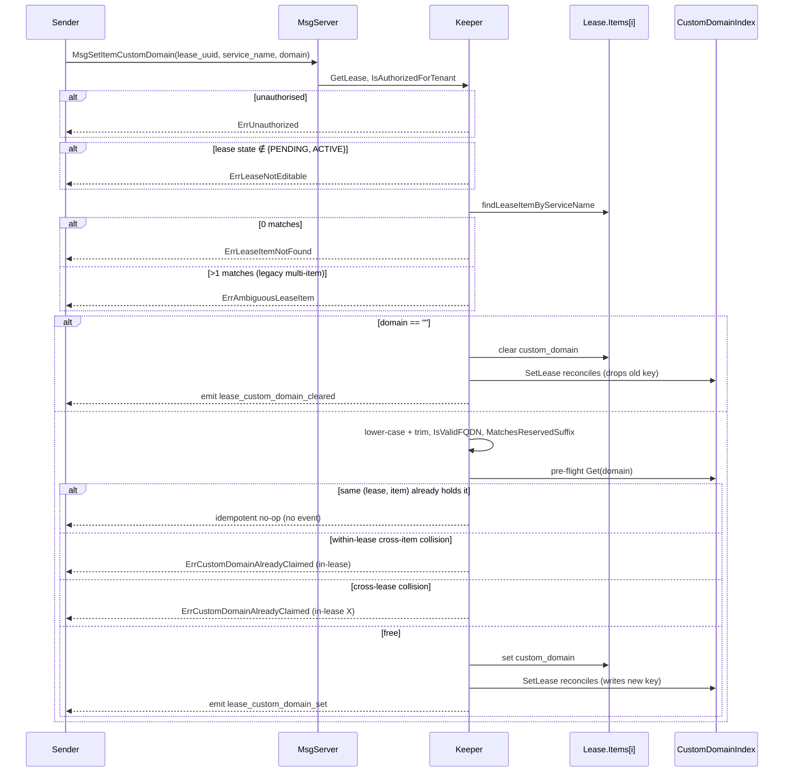

The pre-flight uniqueness check is a UX layer: `SetLease`'s storage-level reconciliation is the defence-in-depth that prevents two simultaneous claims from racing through.

### Index lifecycle

`CustomDomainIndex` entries are created and freed exclusively through `SetLease`'s reconciliation pass. As a result:
- closing a lease (`MsgCloseLease`, or the EndBlocker closing the leases of a stream frozen for exhausted credit);
- rejecting a lease (`MsgRejectLease`);
- a tenant cancelling a pending lease (`MsgCancelLease`);
- a pending lease expiring in EndBlocker;

each free every `custom_domain` the lease held in a single SetLease call. Genesis import re-derives the index from `LeaseItem.custom_domain` values for PENDING/ACTIVE leases only.

### Query

`QueryLeaseByCustomDomain` is the only read path that uses the index. It lower-cases and trims the input domain before lookup so case-insensitive HTTP host headers work without per-caller normalisation. The response carries the full `Lease` plus the `service_name` of the matching item — for a 1-item legacy lease the `service_name` is `""`.

## Settlement Triggers

A stream is settled lazily at these points:

| Trigger | Streams settled | Reason |
|---------|-----------------|--------|
| `Withdraw` | Up to `limit` streams of the provider, in key order | Pay the provider what its streams accrued |
| `AcknowledgeLease` | The streams the acknowledged lease(s) join (one per denom) | The stream's rate is about to grow; what accrued at the old rate is paid first |
| `CloseLease` | The streams the closed lease(s) leave | The stream's rate is about to drop; the lease pays up to now |
| EndBlocker closure of a lease of a frozen stream | The lease's other streams (other denoms) that are still healthy | Same as `CloseLease`. The frozen stream itself accrues nothing and transfers nothing. |

Within one message a stream is settled at most once. A second settlement in the same block accrues nothing, because `last_settled_at` already equals the block time: no time has passed.

**Note**: Queries return stored state and do NOT trigger settlement. `ProviderWithdrawable` computes, without writing, what a settlement would pay now; `StreamsByProvider` and `StreamsByTenant` return the stored streams. Settlement (actual token transfer) only happens during write operations.

**Transaction Ordering Note**: Within a single block, transaction order matters. If a block contains both a `FundCredit` transaction and a transaction that settles one of the same tenant's streams (`Withdraw`, `AcknowledgeLease`, `CloseLease`), the outcome depends on which transaction is processed first. This is standard blockchain behavior—settlement reads the credit balance at the time of execution. A top-up processed before the settlement keeps the stream healthy; a top-up processed after the settlement froze the stream does not unfreeze it (see [Auto-Close on Credit Exhaustion](#auto-close-on-credit-exhaustion)).

### Atomic Settlement in Provider-Wide Withdraw

`Withdraw` uses a **cached context pattern** to make each stream's settlement atomic:

```go
// For each stream key of the page:
cacheCtx, write := sdkCtx.CacheContext()

// Bank transfer, stream update and (on exhaustion) the drain queue entry
settlement, err := k.SettleStream(cacheCtx, key, blockTime)
if err != nil {
    // Discard changes for this stream, continue with the others
    continue
}

// Commit changes only if settlement succeeded
write()
```

**Behavior**:
- Each stream's settlement is atomic (all-or-nothing): the bank transfer, the stream update and, on exhaustion, the drain queue entry commit together or not at all
- If settlement fails for one stream (e.g., a bank transfer error, or a missing or invalid provider payout address), only that stream is skipped and the failure is logged
- Other streams of the page are processed normally
- Failed streams don't affect the success of the overall operation
- A skipped stream keeps its `last_settled_at`, `remainder` and `arrears`, so nothing is lost: it is paid by the next settlement that succeeds

> **Accrual overflow is NOT a skip.** If what a stream owes is not representable — the gap since `last_settled_at` exceeds `MaxDurationSeconds` (~100 years, `keeper/accrual.go`) or the payable amount (accrual plus arrears) does not fit `sdkmath.Int` — the settlement does *not* skip and does *not* preserve the funds. It transfers the tenant's entire remaining credit in the stream's denom to the provider, sets `last_settled_at` to the block time, clears `remainder` and `arrears` and freezes the stream (`keeper/stream.go`), so the EndBlocker closes its leases. This is deliberate — zeroing it out would grant free service to the tenant. Overflow is effectively unreachable in normal operation (a stream would have to go ~100 years without settlement) but can arise from a genesis import with an ancient stream `last_settled_at`.

This pattern ensures that partial failures don't corrupt state while still providing best-effort batch processing.

### Auto-Close on Credit Exhaustion

Credit exhaustion is handled in two steps: a transaction **freezes** the stream, and the EndBlocker **closes** its leases.

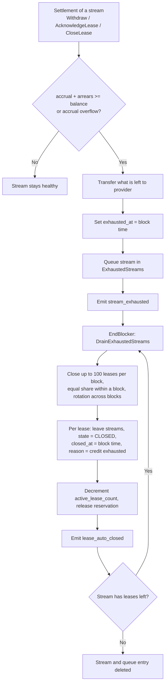

No lease is closed inside the transaction that discovers the exhaustion. That transaction pays for one transfer and one stream write, whatever the number of leases behind the stream.

**Semantics of a frozen stream:**

- It accrues nothing. However long the drain takes, the tenant is not charged for the time between the freeze and the closure, and the provider is not paid for it.
- It keeps its `rate` and `lease_count` until its leases are closed, so the stream invariant holds throughout.
- A top-up after the freeze does not unfreeze it. Its leases are still closed, and the new credit is not spent on it.
- A lease acknowledged into a frozen stream joins it (the tenant may have topped up enough to create a new lease) and is closed with the stream's other leases.
- A tenant, provider or authority may still close a lease of a frozen stream with `MsgCloseLease` before the EndBlocker reaches it. The lease is then recorded with `closure_reason = "credit exhausted"`. Closing the last lease this way deletes the stream and its queue entry.
- Once the stream is drained and deleted, a new lease for the same `(provider, tenant, denom)` starts a fresh, healthy stream.

**Multi-denom leases.** A lease priced in two denoms belongs to two streams. When one of them freezes, the drain closes the lease and removes it from the other stream too; that healthy stream is settled up to the closing block first, then its rate drops. Leases of the same tenant that are not priced in the exhausted denom are untouched.

## EndBlocker

The billing module's EndBlocker does two things, in this order: it expires pending leases that exceeded the timeout, then it closes the leases of streams frozen for exhausted credit. Both are bounded per block.

### Pending Lease Expiration

Leases that remain in `PENDING` state beyond the `pending_timeout` (default 30 minutes) are automatically expired:

```go
func (k Keeper) EndBlocker(ctx context.Context) error {
    sdkCtx := sdk.UnwrapSDKContext(ctx)
    now := sdkCtx.BlockTime()
    params, err := k.GetParams(ctx)
    if err != nil {
        return err
    }
    pendingTimeout := time.Duration(params.PendingTimeout) * time.Second

    // Two-pass approach to avoid iterator invalidation.
    // Pass 1: collect UUIDs of expired pending leases by range-querying the
    // StateCreatedAt index (keyed ((state, created_at), uuid)) for
    // created_at < now - pendingTimeout, so only expirable leases are visited
    // (O(expired) instead of O(total pending)). The upper bound is exclusive at
    // the cutoff because expiry is strict (created_at < cutoff).
    cutoff := now.Add(-pendingTimeout)
    pendingState := int32(types.LEASE_STATE_PENDING)
    scanRange := new(collections.Range[collections.Pair[collections.Pair[int32, time.Time], string]]).
        StartInclusive(collections.Join(collections.Join(pendingState, time.Time{}), "")).
        EndExclusive(collections.Join(collections.Join(pendingState, cutoff), ""))
    iter, err := k.Leases.Indexes.StateCreatedAt.Iterate(ctx, scanRange)
    if err != nil {
        return err
    }
    var expiredUUIDs []string

    for ; iter.Valid(); iter.Next() {
        if len(expiredUUIDs) >= types.MaxPendingLeaseExpirationsPerBlock {
            break // Rate limit: max 100 per block
        }
        leaseUUID, err := iter.PrimaryKey()
        if err != nil {
            // per-lease errors are logged and skipped, never fatal
            continue
        }
        lease, err := k.Leases.Get(ctx, leaseUUID)
        if err != nil {
            continue
        }
        // Defense-in-depth: the range already guarantees created_at < cutoff.
        expirationTime := lease.CreatedAt.Add(pendingTimeout)
        if now.After(expirationTime) {
            expiredUUIDs = append(expiredUUIDs, leaseUUID)
        }
    }
    iter.Close()

    // Pass 2: Expire collected leases (safe to modify state).
    // Each lease is re-fetched; per-lease errors are logged and skipped, never fatal.
    for _, leaseUUID := range expiredUUIDs {
        lease, err := k.Leases.Get(ctx, leaseUUID)
        if err != nil {
            continue
        }
        if err := k.ExpirePendingLease(ctx, &lease); err != nil {
            continue
        }
    }

    // Close the leases of streams frozen for exhausted credit (bounded per block).
    k.DrainExhaustedStreams(ctx, params.MinLeaseDuration)

    return nil
}
```

#### Rate Limiting

To prevent DoS attacks where an attacker creates many pending leases to overload the EndBlocker:

1. **Max 100 expirations per block** - Ensures bounded computation
2. **Max pending leases per tenant** (default 10) - Limits spam from individual accounts
3. **Remaining leases expire in subsequent blocks** - No lease is left indefinitely
4. **Time-bounded index scan** - The StateCreatedAt index is range-queried for `created_at` before the cutoff (`created_at < blockTime - pending_timeout`), so EndBlocker visits only expirable leases, not all pending ones
5. **Two-pass approach** - Avoids iterator invalidation during state modification

#### Lease State on Expiration

When a lease expires:
- State changes from `PENDING` → `EXPIRED`
- `expired_at` timestamp is set
- `pending_lease_count` is decremented
- The lease's reservation is released from `CreditAccount.reserved_amounts` (via `ReleaseLeaseReservation`), freeing the credit for new leases
- Credit remains in tenant's account (was never billed since lease never activated)
- The whole expiration is `CacheContext`-atomic; the `lease_expired` event is emitted on the parent context after commit

### Exhausted Stream Drain

`DrainExhaustedStreams` (`keeper/stream_drain.go`) closes the leases of streams that a settlement froze for exhausted credit (see [Auto-Close on Credit Exhaustion](#auto-close-on-credit-exhaustion)). It follows the pattern x/feegrant uses to prune expired grants: work that cannot be done inside a transaction is queued and drained in the EndBlocker with a per-block cap.

Per block:

1. **Collect** (`collectExhaustedStreams`). Read up to `MaxAutoClosesPerBlock` (100) entries of the `ExhaustedStreams` queue, then close the iterator (draining deletes entries from the collection being iterated). Every stream needs at least one attempt, so more than 100 queued streams cannot be served in one block. If `ExhaustedStreamsStart` is set, the walk starts after that key and wraps around to the beginning, up to and including it; otherwise it starts at the head of the queue.
2. **Fair pass.** Give every collected stream an equal share of the budget, `max(1, 100 / number of streams)` closure attempts, in queue order. In this pass the stream's leases are read starting after its cursor and wrapping around to the beginning, so leases skipped in an earlier block are retried.
3. **Remainder pass.** Spend whatever budget is left in queue order, each stream taking as much as it can use. This pass only moves forward from each stream's cursor, so a lease that failed in the fair pass is not retried in the same block.
4. Stop when 100 closures have been attempted. The rest is done in the following blocks.
5. **Rotate.** If more streams are queued than were collected, save the key of the last collected stream in `ExhaustedStreamsStart`, so the next block resumes after it. If the whole queue fitted in this block and a start key was set, clear it. With a short queue nothing is written: every queued stream is served every block.

In both passes, for each stream (`drainStream`):
- Drop the entry if the stream no longer exists or is no longer frozen (dangling entry).
- Collect its share of member leases from `StreamLeases`.
- If the frozen stream has no member lease at all (state has drifted), log it and delete the stream rather than rescan it forever.
- Close each collected lease in its own `CacheContext` (`closeExhaustedLease`).

The drain is fair to streams in two ways, because a frozen stream can keep receiving newly acknowledged leases and so can stay non-empty indefinitely:

- **Equal share within a block.** Without the fair pass, one such stream could hold the head of the queue and absorb every block's budget, starving the streams collected with it.
- **Rotation across blocks.** Sharing the budget only helps the streams collected in a block. With 100 or more frozen streams kept non-empty and sorting ahead of another frozen stream, the head of the queue would be collected every block and the stream behind never served. Resuming after the last stream served makes the walk cover the whole queue, which bounds every stream's wait. `TestAdversarial_EndBlockerDrainCannotBeStarvedByRefilledStreams` pins this.

With a single frozen stream the two passes together behave like a plain cap: up to 100 of its leases are closed per block.

Closing one lease (`closeExhaustedLease`) is atomic: the lease, its streams, the credit account and the event commit together or not at all.

- The lease leaves every stream it belongs to (through a `streamCache`, so a healthy sibling stream in another denom is settled up to the block time before its rate drops)
- State changes from `ACTIVE` → `CLOSED`, `closed_at` = block time, `closure_reason` = `"credit exhausted"`
- `SetLease` reconciles the indexes, including the `custom_domain` reverse index
- `active_lease_count` is decremented and the lease's reservation is released
- Streams left without leases are deleted, together with their queue entry
- `lease_auto_closed` is emitted (`lease_uuid`, `tenant`, `provider_uuid`, `reason = credit_exhausted`). Because it is emitted from the EndBlocker, it is a block event: it appears in the block's `finalize_block_events`, not in any transaction's result.

#### Failure Isolation

EndBlocker work is not gas-metered and an error returned from it halts the chain, so the drain never returns one:

1. **Max 100 closure attempts per block** - Attempts are counted, not successes, so a stream of leases that all fail cannot consume unbounded work. The budget is shared between the streams served in a block, and the walk of the queue rotates across blocks, so such a stream cannot consume the other streams' share or keep them from being served
2. **One `CacheContext` per lease** - A failed closure leaves no partial state
3. **Panics are recovered** - `closeExhaustedLease` converts a panic into an error for that lease
4. **Cursor past failures** - A lease that cannot be closed is logged and the stream's cursor is moved past it, so the next block starts with the leases behind it; the wrap-around of a later block's fair pass retries it once those have been served
5. **Stale entries are removed** - A membership entry whose lease is gone or not `ACTIVE` is deleted so the drain can make progress

## Credit Account Multi-Denom Support

Credit accounts support multiple token denominations. Since credit accounts are regular bank module accounts, they can hold any token type. This enables:

- Different SKUs can use different payment tokens
- Tenants fund their credit with the tokens required by their target SKUs
- Settlement transfers happen per stream, and a stream has exactly one denom, so each transfer to the provider's payout address carries a single denom

**No send restrictions** are applied to credit accounts - any token can be sent to them.

## UUIDv7 Generation

The module uses deterministic UUIDv7 generation for all identifiers (providers, SKUs, leases):

### Why UUIDv7?

- **Time-ordered**: Embeds millisecond timestamp, enabling natural sorting
- **Deterministic**: All validators generate identical UUIDs for the same block
- **Debugging**: Easier to trace and correlate with external systems
- **Future-proof**: No practical limit vs uint64

### Generation Strategy

```go
// UUIDv7 format: timestamp (48 bits) + version (4 bits) + sequence (12 bits) + variant (2 bits) + node (62 bits)
func GenerateUUIDv7(ctx sdk.Context, moduleName string, sequence uint64) string {
    blockTime := ctx.BlockTime()
    headerHash := ctx.HeaderHash()
    chainID := ctx.ChainID()
    timestamp := blockTime.UnixMilli()

    // Deterministic node ID from header hash + chain ID + module name + sequence
    // Uses FNV-1a hash for determinism across all validators
    nodeID := hashEntropy(headerHash, chainID, moduleName, sequence)

    // Combine: timestamp + version(7) + sequence + variant + nodeID
    return formatUUIDv7(timestamp, sequence, nodeID)
}
```

See `pkg/uuid/uuid.go` for the full implementation.

## Accrual Calculation

**Important**: Billing only accrues for ACTIVE leases. PENDING leases do not accrue charges. Billing starts from `acknowledged_at` timestamp, which is when the lease joins its streams.

### Per-Second Rate (at Lease Creation)

The `locked_price` stored in `LeaseItem` is already the per-second rate, calculated at lease creation:

```go
// During lease creation
lockedPricePerSecond, err := ConvertBasePriceToPerSecond(sku.BasePrice, sku.Unit)
```

`ConvertBasePriceToPerSecond` (`x/billing/keeper/accrual.go`) wraps `skutypes.CalculatePricePerSecond`, re-attaching the SKU's `base_price` denom so the result is an `sdk.Coin` suitable for `LeaseItem.locked_price`. It returns an error on unknown unit, a zero per-second rate, or inexact division; at lease creation this surfaces as `ErrSKUNotFound.Wrapf("invalid SKU pricing: %s", err)`.

### Accrual Formula

Accrual is computed per stream, from the stream's aggregate rate:

```
lease_rate[denom]  = sum(locked_price.Amount × quantity) over the lease's items in that denom
stream.rate        = sum(lease_rate[denom]) over the stream's ACTIVE leases

elapsed_ns         = block time − stream.last_settled_at, in nanoseconds
total              = stream.remainder + stream.rate × elapsed_ns
accrued            = total / 1,000,000,000     (whole units of the denom)
stream.remainder   = total % 1,000,000,000     (carried to the next settlement)
due                = stream.arrears + accrued
transfer           = min(due, tenant credit balance in the stream's denom)
stream.arrears     = 0
stream.last_settled_at = block time
```

Rates are per second and block time has nanosecond precision, so the product `rate × elapsed_ns` is in (denom units × nanoseconds); dividing by 10⁹ gives whole units. The part that does not amount to a whole unit is not paid and not dropped: it stays in `remainder`, which is therefore always in `[0, 1,000,000,000)`. Two properties follow:

- **Nothing is lost between settlements, however often a stream is settled.** At rate 1 per second, a settlement after 1.5s pays 1 and keeps a remainder of 500,000,000; a further settlement 0.5s later pays the second unit. The total paid over any period is the same whether the stream was settled once or many times.
- **A lease is never charged for time before it joined.** `last_settled_at` always moves to the settlement time, so when a lease joins mid-second the higher rate only applies from that instant on.

`stream.rate` is maintained incrementally: it grows by `lease_rate` when a lease is acknowledged and drops by it when the lease is closed, and the stream is settled at the old rate first in both cases. Each lease is therefore charged `lease_rate` for exactly the time it was ACTIVE, as long as the tenant's credit covers it.

A stream last settled at or after the block time accrues nothing, and a frozen stream accrues nothing, owes nothing and keeps its `remainder` as it was.

**Arrears.** `arrears` is an amount the stream owes on top of its accrual, kept as a field of its own in whole units of the denom. What a stream owes at time `t` is `arrears + floor((remainder + rate × elapsed_ns) / 1,000,000,000)`. A settlement pays the arrears with the accrual in one transfer and sets them to 0. If the tenant's credit does not cover the total, the settlement pays the whole balance and freezes the stream as for any shortfall; the unpaid part is not kept on the frozen stream. A settlement that fails (for example, an unusable payout address) changes nothing, so the arrears stay for the next one. `ProviderWithdrawable`, `Withdraw`, `CreditEstimate` (which deducts it as unsettled) and the stream queries all include it.

The only writer of a non-zero `arrears` is the 2 → 3 store migration, which records there what each stream's leases had accrued under per-lease settlement and not yet been paid at the upgrade (see [Migration Guide](MIGRATION.md#store-migration-2--3-settlement-streams)). It is kept apart from `last_settled_at` and `remainder` so that it is exact whatever its size and whatever the stream's rate; see [Design Decisions](DESIGN_DECISIONS.md).

The intermediate `rate × elapsed_ns + remainder` is computed with arbitrary precision (`math/big`). It is 10⁹ times larger than the amount it yields, so it may exceed the 256 bits of `sdkmath.Int` while the charge itself fits; only the payable amount has to fit.

Off-chain, `rate × whole seconds since last_settled_at` is a good estimate of what a stream has accrued, but it is an approximation: the chain's figure also includes the carried `remainder` and the fraction of a second elapsed. What the stream owes is that accrual plus its `arrears`, capped at the tenant's balance. `ProviderWithdrawable` returns the exact amount.

### Multi-Denom Settlement

When a lease contains SKUs with different denominations:
1. The lease's per-second rate is computed per denomination (`types.LeaseRatesPerSecond`)
2. The lease joins one stream per denomination: `(provider, tenant, denom)`
3. Each stream is settled, capped and frozen independently, against the tenant's credit balance in its own denom

A tenant can therefore be exhausted in one denom and healthy in another. A lease priced in the exhausted denom is closed; leases priced only in other denoms continue.

### Example

SKU 1: 3600upwr per hour → 1upwr per second (locked_price = {denom: "upwr", amount: 1})
SKU 2: 7200umfx per hour → 2umfx per second (locked_price = {denom: "umfx", amount: 2})
Quantities: SKU 1 = 5 instances, SKU 2 = 3 instances
Elapsed: 100 seconds

```
lease_rate        = [5upwr/s, 6umfx/s]
upwr stream       : rate 5 → accrued = 5 × 100 = 500upwr
umfx stream       : rate 6 → accrued = 6 × 100 = 600umfx
```

If the same tenant acknowledges a second, identical lease with the same provider, no new stream is created: the two existing streams go to rate 10 and 12, and a withdrawal still makes two transfers.

## Parameters, Events, and Error Codes

For the complete reference of module parameters, events, error codes, and authorization matrix, see [API Reference](API.md).

**Architecture Notes:**
- Parameters are stored at key prefix `0x00` using the Collections `Item` type
- Withdraw limits (streams per call; default: 50, max: 100) and the EndBlocker auto-close cap (100 per block) are compile-time constants, not governance parameters
- Each SKU defines its own denomination—no global denom parameter exists

## Security Considerations

### Overflow Protection

Accrual is computed without intermediate overflow and reports an unrepresentable result instead of panicking:

```go
// streamAccrual computes what a stream has accrued at now: remainder + rate ×
// elapsed nanoseconds, divided by 1e9. A frozen stream, or one last settled at
// or after now, accrues nothing. ok is false when the accrual is not
// representable: the gap exceeds MaxDurationSeconds, or the amount payable
// does not fit sdkmath.Int.
//
// The intermediate product is computed with arbitrary precision. rate × elapsed
// nanoseconds is 1e9 times larger than the amount it yields, so it can exceed
// the 256 bits of sdkmath.Int while the charge itself fits comfortably; only
// the charge decides whether the accrual is representable.
func streamAccrual(state types.StreamState, now time.Time) (accrued, remainder sdkmath.Int, ok bool) {
    remainder = streamRemainder(state)
    if state.IsExhausted() {
        return sdkmath.ZeroInt(), remainder, true
    }

    elapsed := now.Sub(state.LastSettledAt)
    if elapsed <= 0 {
        return sdkmath.ZeroInt(), remainder, true
    }
    if int64(elapsed/time.Second) > MaxDurationSeconds {
        return sdkmath.ZeroInt(), sdkmath.ZeroInt(), false
    }

    total := new(big.Int)
    if !state.Rate.IsNil() {
        total.Mul(state.Rate.BigInt(), big.NewInt(int64(elapsed)))
    }
    total.Add(total, remainder.BigInt())

    units, rest := new(big.Int).QuoRem(total, nanosPerSecond, new(big.Int))
    if units.BitLen() > sdkmath.MaxBitLen {
        return sdkmath.ZeroInt(), sdkmath.ZeroInt(), false
    }
    return sdkmath.NewIntFromBigInt(units), sdkmath.NewIntFromBigInt(rest), true
}
```

What a stream owes is this accrual plus its `arrears` (`streamDue`), added with an overflow check. Overflow therefore means one of two things: the gap since `last_settled_at` exceeds `MaxDurationSeconds`, or the payable amount itself (the accrual, or the accrual plus arrears) does not fit `sdkmath.Int`. A large rate whose intermediate product exceeds 256 bits is not an overflow as long as the charge fits, so such a stream is settled normally rather than treated as exhausted.

An unrepresentable accrual certainly exceeds the tenant's balance, so the settlement pays the provider everything that remains and freezes the stream. The same care applies where rates are built: `types.LeaseRatesPerSecond` returns an error on overflow, and a lease whose rate would overflow its stream's rate cannot be acknowledged (`ErrInvalidLease`).

### DoS Mitigations

1. **Max leases per tenant** - Prevents active lease spam
2. **Max pending leases per tenant** - Prevents pending lease spam
3. **Max items per lease** - Limits computation per lease
4. **Withdrawal batch size** - Caps the streams settled per withdraw (max 100)
5. **Min lease duration** - Prevents immediate exhaustion
6. **Lazy stream settlement** - No per-block overhead for accrual calculation, and the cost of a settlement does not grow with the number of leases in the stream
7. **EndBlocker rate limiting** - Max 100 pending lease expirations and max 100 auto-close attempts per block
8. **Indexed lookups** - `CreditAddressIndex` (prefix 6) is a maintained reverse index (`credit_address → tenant`) written by `SetCreditAccount`. It is not read anywhere in the current tree, but enables O(1) credit-account detection for future or off-chain consumers
9. **Same provider requirement** - Simplifies acknowledgement flow

## Performance Characteristics

| Operation | Complexity | Notes |
|-----------|------------|-------|
| FundCredit | O(1) | Bank transfer + storage write |
| CreateLease | O(m) | m = items in lease |
| AcknowledgeLease | O(l×m + s) | l = leases in the message (max 100), m = items per lease, s = distinct streams touched (each settled and written once) |
| RejectLease | O(1) | State change + index updates |
| CancelLease | O(1) | State change + index updates |
| CloseLease | O(l×m + s) | Same as AcknowledgeLease. Independent of how many other leases the touched streams aggregate. |
| Withdraw | O(s) | s = streams of the provider in the page (default 50, max 100). Independent of the number of leases and items: one transfer and one stream write per stream, no lease read. |
| GetCreditBalance | O(1) | Bank query |
| GetLeasesByTenant | O(n) | n = tenant's leases |
| GetLeasesByTenant (with state filter) | O(k) | k = matching leases (compound index) |
| GetLeasesByProvider | O(n) | n = provider's leases |
| GetLeasesByProvider (with state filter) | O(k) | k = matching leases (compound index) |
| GetPendingLeasesByProvider | O(k) | k = pending leases (compound index) |
| GetLeasesBySKU | O(k) | k = leases containing the SKU (SKU index) |
| ProviderWithdrawable | O(s) | s = streams of the provider in the page (default 100, max 1000) |
| StreamsByProvider / StreamsByTenant | O(s) | s = streams in the page (default 100, max 1000) |
| CreditEstimate | O(s) | s = streams of the tenant (`StreamsByTenant` reverse lookup), not its leases |
| EndBlocker | O(e + c) | e = expirable pending leases (created_at before cutoff, i.e. older than blockTime − pending_timeout), capped at 100/block via time-bounded StateCreatedAt scan; c = auto-close attempts on leases of frozen streams, capped at 100/block, shared between the streams served in the block, with the queue walked in rotation across blocks. Never scans the full set of leases or streams. |

### Future Improvements

The following optimizations have been identified but deferred:

| Index/Feature | Current | Potential | Notes |
|---------------|---------|-----------|-------|
| `LeasesBySKU` + State filter | O(k) + post-filter | O(m) direct | Cannot create compound (SKU, State) index due to many-to-many design (leases contain multiple SKUs). Current post-filtering is acceptable since SKU-specific queries are infrequent. |

## Genesis Validation

During `InitGenesis`, the billing module performs cross-module validation to ensure data consistency, restores the settlement streams and verifies them against the leases:

### SKU-Provider Validation

For each lease in the genesis state, the module verifies:

1. **Provider Existence**: The lease's `provider_uuid` must reference an existing provider in the SKU module
2. **SKU Existence**: Each `LeaseItem.sku_uuid` must reference an existing SKU in the SKU module
3. **SKU-Provider Relationship**: Each SKU must belong to the lease's claimed provider

```go
// Example validation during InitGenesis
for i, item := range lease.Items {
    sku, err := k.skuKeeper.GetSKU(ctx, item.SkuUuid)
    if err != nil {
        return fmt.Errorf("lease %s item %d references non-existent SKU %s",
            lease.Uuid, i, item.SkuUuid)
    }
    if sku.ProviderUuid != lease.ProviderUuid {
        return fmt.Errorf("lease %s item %d SKU %s belongs to provider %s, not %s",
            lease.Uuid, i, item.SkuUuid, sku.ProviderUuid, lease.ProviderUuid)
    }
}
```

This validation prevents inconsistent state where a lease claims to be for one provider but uses SKUs from a different provider.

### Credit Account Validation

The module also validates credit accounts:

1. **Address Derivation**: Credit address must match the deterministically derived address from the tenant
2. **Tenant Uniqueness**: No duplicate credit accounts for the same tenant

Tenants are compared by address, not by spelling. A lease and its credit account may store the same tenant in different (upper/lower case) bech32 spellings, so the cross-checks between leases and credit accounts (reservations, active and pending lease counts, duplicate accounts) key on `types.CanonicalAddress`.

### Stream Validation

`GenesisState.streams` carries the settlement streams, and they must be exactly the streams the ACTIVE leases imply. The check runs in both directions and at two levels:

1. **`GenesisState.Validate`** (stateless, `types/genesis.go`), through `GenesisState.ValidateStreams`:
   - a lease that carries the deprecated `last_settled_at` is rejected: such a genesis was exported before stream settlement and its leases have no streams
   - every stream has a valid tenant address, a positive `rate`, a non-zero `last_settled_at`, a `remainder` in `[0, 1,000,000,000)`, `arrears` that are not negative, and is not duplicated. Streams are matched to leases by canonical tenant address, so the spelling of `Stream.tenant` and `Lease.tenant` need not agree
   - every stream corresponds to at least one ACTIVE lease, and its `rate` and `lease_count` equal what those leases sum to (`types.ExpectedStreamAggregates`)
   - every stream the ACTIVE leases imply is present
2. **`ValidateWithBlockTime`** (at `InitGenesis`): a stream's `last_settled_at` and `exhausted_at` must not be after the block time. A stream settled in the future would accrue nothing until block time caught up, giving the tenant free service.
3. **`InitGenesis`** runs `GenesisState.ValidateStreams` itself (the checks of step 1), because `GenesisState.Validate` is not run on InitChain and a malformed stream moves money: one without `last_settled_at` would look centuries overdue and pay the tenant's whole credit to the provider on its first settlement. It then restores each stream and rebuilds the state derived from it and from the leases: the `StreamsByTenant` reverse lookup, the `ExhaustedStreams` queue (one entry per stream with `exhausted_at` set, cursor empty) and the `StreamLeases` membership entries (from the ACTIVE leases). Finally it runs `CheckStreamInvariant` on the stored state as defence in depth and fails the import on any mismatch.

Only `Streams` is exported; the three derived collections (`StreamsByTenant`, `StreamLeases`, `ExhaustedStreams`) are rebuilt on import. The drain's own bookkeeping is not exported either: `ExportGenesis` → `InitGenesis` resets every per-stream drain cursor and the queue rotation key (`ExhaustedStreamsStart`), so after an import the drain starts again at the head of the queue.

## Testing Strategy

### Unit Tests (`x/billing/keeper/*_test.go`)
- Message validation (`ValidateBasic`)
- Accrual calculations
- Stream settlement (`stream_test.go`): join/leave, exact accrual across settlements (carried remainder), a joining lease not billed before it joined, partial/full credit exhaustion, freeze then EndBlocker drain, multi-denom leases, withdraw pagination and cursor, gas independent of lease count
- Store migration 2 → 3 (`migrations_test.go`)
- Stream/lease consistency invariant, checked after state-changing tests
- Lease lifecycle (PENDING → ACTIVE → CLOSED)
- Provider acknowledgement/rejection
- Tenant cancellation
- Pending expiration
- Authorization checks (tenant, provider, authority)
- Error scenarios (non-existent lease, unauthorized, wrong state)
- Genesis import/export with cross-module validation

### Integration Tests (`x/billing/keeper/*_test.go`)
- Full message flows with real app context
- Multi-lease scenarios
- Credit account lifecycle
- EndBlocker pending expiration and exhausted-stream drain

### E2E Tests (`interchaintest/billing_test.go`)
- Complete billing cycle with PENDING → ACTIVE flow
- Provider acknowledgement and rejection
- Tenant lease cancellation
- Provider withdrawals
- Multi-denom scenarios
- Credit exhaustion and auto-close

### Group/POA Tests (`interchaintest/poa_group_test.go`)
- Provider/SKU management via group proposals
- Lease creation for tenants via authority
- Lease acknowledgement via group proposals
- Withdrawal via group proposals

### Simulation (`x/billing/simulation/`)
- Random operations including acknowledge/reject
- Stress testing
- State consistency

## Scalability Considerations

This section documents architectural decisions that affect scalability and outlines future improvement plans.

### Lazy Settlement Design

The billing module uses **lazy settlement** (on-touch evaluation) instead of per-block accrual, and settles per **stream** instead of per lease:

| Approach | Complexity | Trade-offs |
|----------|------------|------------|
| Per-block settlement | O(n) per block | Simple but doesn't scale; EndBlocker grows with lease count |
| Lazy settlement per lease | O(leases) per withdrawal | No per-block cost, but a provider's withdrawal fee grows linearly with its lease count (about 93k gas per lease) |
| Lazy settlement per stream | O(streams) per withdrawal | No per-block cost; a withdrawal costs the same whether a stream aggregates 1 lease or hundreds (about 54k gas for one stream) |

A stream is one `(provider, tenant, denom)`. The number of streams a provider has is the number of tenant and denom pairs it serves, and it does not grow when a tenant adds leases: a tenant running 382 leases with one provider in one denom is a single stream. This follows the Cosmos SDK F1 fee-distribution idiom: keep a per-pair aggregate up to date lazily and pay on withdrawal, instead of iterating the underlying positions. See [Design Decisions](DESIGN_DECISIONS.md) for the alternatives considered.

**Why lazy settlement works:**
- Settlement cost is paid by the party initiating the operation (withdraw, acknowledge, close)
- No per-block overhead regardless of total lease count
- What a stream has accrued but not yet settled stays in the tenant's credit account until a settlement moves it; `CreditEstimate` deducts it when estimating how long the credit will last
- Provider incentivized to withdraw regularly (they bear the risk of tenant credit exhaustion)

**What the EndBlocker still does:** only work that is already known to be needed. It closes the leases of streams a settlement has frozen, from a queue and with a per-block cap. It never computes accrual and never scans leases to look for exhausted credit, so a tenant whose credit has run out keeps its leases `ACTIVE` until a write operation settles the stream.

### Credit Withdrawal Policy

There is no mechanism for tenants to withdraw unused credit from credit accounts. Once tokens are funded, they can only be spent on leases. This design:

- **Mimics typical cloud providers** (AWS credits, etc.)
- **Prevents gaming**: Without this restriction, tenants could fund credit, create leases to lock in prices, then withdraw if prices drop
- **Simplifies accounting**: Credit balance always represents available purchasing power
- **Future consideration**: A governance-controlled refund mechanism could be added if needed

### Provider/SKU Deactivation Behavior

When a provider or SKU is deactivated:

| Entity | Effect on SKUs | Effect on Existing Leases | Effect on New Leases |
|--------|---------------|--------------------------|---------------------|
| Provider deactivated | **All SKUs cascade to inactive** | Continue at locked prices | Cannot create |
| SKU deactivated | Only that SKU affected | Continue at locked prices | Cannot create |
| Provider reactivated | SKUs remain inactive* | No change | Requires SKU reactivation |
| SKU reactivated | That SKU becomes active | No change | Can create (if provider active) |

*SKUs must be individually reactivated via `update-sku` after provider reactivation.

**Cascade behavior**: `DeactivateProvider` deactivates the provider immediately and then deactivates its active SKUs in pages of `limit` (default 50, max 100). If the response's `has_more` is `true`, active SKUs remain and the caller must re-invoke `DeactivateProvider` with the same UUID until `has_more == false`. Until the cascade completes, an inactive provider may transiently still have active SKUs.

**Implementation note**: The billing module queries SKU/provider status at lease creation time. Existing leases store `provider_uuid` and `locked_price`, making them independent of subsequent provider/SKU state changes. Tenants can close their leases at any time, even after provider/SKU deactivation.

### Provider-Wide Withdraw Batch Processing

Withdraw (`--provider` flag) processes the provider's streams in batches to prevent DoS:

```
Default limit: 50 streams
Maximum limit: 100 streams (hard cap)
```

**Handling large provider portfolios:**
1. Provider calls `withdraw --provider <uuid>` with desired `--limit` (no `--key` on the first call)
2. Response includes `has_more` and an opaque `next_key` cursor
3. If `has_more == true`, provider repeats the call passing `--key <next_key>` to advance
4. Streams are processed in key order (tenant address, then denom); the cursor (`StartExclusive`) resumes strictly after `next_key`, so each call advances instead of re-scanning the front

`next_key` is a `bytes` cursor encoding the `(tenant, denom)` of the last stream of the page, so it is base64-encoded in JSON/CLI output; pass it verbatim to `--key` (it is not a UUID).

**Gas considerations**: Each batch is a single transaction, and its cost depends on the number of streams in the page, not on the leases behind them. A provider needs more than one transaction only when it serves more than `--limit` tenant and denom pairs; a provider with hundreds of leases from a handful of tenants withdraws in one.

### Time Manipulation Considerations

The billing module relies on block timestamps for accrual calculations. Cosmos SDK provides the following guarantees:

| Property | Guarantee |
|----------|-----------|
| Monotonicity | Block time always increases (enforced by CometBFT) |
| Granularity | Millisecond precision |
| Drift tolerance | ±1 second per block (CometBFT default) |

**Attack surface analysis:**

1. **Validator timestamp manipulation**: Limited to ±1 second per block. Over 1 hour, maximum drift is ~0.028%. Not economically viable for manipulation.

2. **Network partition attacks**: Timestamps during partitions may differ slightly across chains. Resolved during consensus.

3. **Leap seconds**: Go's time package handles leap seconds transparently.

**Mitigations implemented:**
- `MinLeaseDuration` prevents micro-leases that could amplify timing attacks
- Per-second billing granularity absorbs small timing variations
- Price locking means timestamp manipulation only affects billing duration, not rates

### Arithmetic Precision

All billing calculations are integer arithmetic. Stored amounts and rates are `sdkmath.Int` (integers of up to 256 bits); the intermediate accrual product is computed with arbitrary precision (`math/big`):

```go
// Accrual calculation (no floating point)
stream_rate = sum(locked_price × quantity)   // over the stream's ACTIVE leases
total       = remainder + stream_rate × elapsed_nanoseconds   // arbitrary precision
accrued     = total / 1e9                    // whole units of the denom, paid; must fit sdkmath.Int
remainder   = total % 1e9                    // carried to the next settlement
```

**Why integer arithmetic:**
- No rounding errors accumulate over time: the division by 10⁹ is the only one, and its rest is carried in `remainder` instead of being dropped
- Deterministic across all validators
- SKU prices must be divisible by unit seconds (enforced at creation)

**Overflow protection:**
- `MaxDurationSeconds` (~100 years) bounds the gap a stream may accrue in one settlement
- The intermediate `rate × elapsed_nanoseconds + remainder` cannot overflow: it is 10⁹ times larger than the charge and is computed with arbitrary precision, so a large rate is never mistaken for an exhausted stream
- `streamAccrual` reports an unrepresentable accrual (a gap beyond `MaxDurationSeconds`, or a payable amount that does not fit `sdkmath.Int`) instead of wrapping or panicking; the settlement then pays the remaining credit and freezes the stream
- Withdraw settles each stream in its own cached context to isolate failures

### Future Improvement Plans

The following enhancements are under consideration:

| Feature | Status | Description |
|---------|--------|-------------|
| Credit refund mechanism | Planned | Governance-controlled tenant credit withdrawal |
| Scheduled withdrawals | Proposed | Auto-withdraw at configurable intervals |
| Lease renewal | Proposed | Extend leases without close/create cycle |
| Multi-provider leases | Deferred | Single lease spanning multiple providers |
| Tiered pricing | Deferred | Volume discounts within single lease |

**Not planned:**
- Per-block settlement (conflicts with scalability goals)
- Negative credit/debt (complexity outweighs benefit)
- Partial lease modification (close and create new lease instead)

## Provider Off-Chain API Integration

For details on how tenants authenticate to provider off-chain APIs using ADR-036 signatures, see [Integration Guide](INTEGRATION.md).

## Related Documentation

- [README](../README.md) - Module overview
- [API Reference](API.md) - CLI and gRPC/REST API
- [Design Decisions](DESIGN_DECISIONS.md) - Key design rationale
- [Comparison](COMPARISON.md) - Comparison with Akash and architectural trade-offs
- [Capabilities](CAPABILITIES.md) - Feature overview and roadmap
- [SKU Module Architecture](../../sku/docs/ARCHITECTURE.md) - Provider and SKU internals
